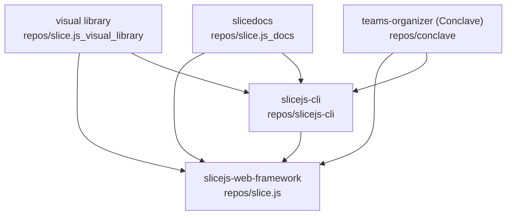

# CONTEXT.md — the Slice.js ecosystem in one place

Context document for humans and agents. `AGENTS.md` defines **how to work**; this file defines
**what each piece is and how they connect**. If something here contradicts the code, the code
wins (and this file should be updated).

## 1. Core idea

Slice.js is developed across several independent repositories that are published as npm packages:
framework, CLI, visual library, documentation and products. The traditional loop is:

```
edit slice.js -> publish slicejs-web-framework -> bump the product -> install -> test
```

`slice-workspace` short-circuits that loop with pnpm local links:

```
edit repos/slice.js/Slice/... -> reload Conclave -> see the change
```

There is no `npm publish` in the inner loop, no manual copy into the pnpm store and no hand-cloning
(`pnpm bootstrap` does it). Every repo stays independent and publishable.

## 2. Repositories

| Directory | npm package | Local version | Role | Remote |
|---|---|---|---|---|
| `repos/slice.js` | `slicejs-web-framework` | 4.0.2 | Framework runtime + `api/framework` + demo app | `vkneider/slice.js` |
| `repos/slicejs-cli` | `slicejs-cli` | 4.3.0 | CLI: dev server, build, init, components, types | `vkneider/slicejs-cli` |
| `repos/slice.js_visual_library` | `slicejs-webframework-visual-components-library` | 1.5.0 | Visual/service components, registry, component docs, DOM e2e | `VKneider/slice.js_visual_library` |
| `repos/slice.js_docs` | `slicedocs` | 3.8.0 | Markdown-generated documentation site | `vkneider/slice.js_docs` |
| `repos/conclave` | `teams-organizer` | 1.0.0 | Real production product (group decision-making) | `vkneider/conclave` |

All local workspace branches are `master`.

## 3. Dependency graph



`pnpm-workspace.yaml` forces **all** of those arrows to point at the local checkouts. In a
standalone clone, they point at the registry.

## 4. How a Slice app boots and is served

### Development

1. The browser loads `src/App/index.js`, which imports `'/Slice/Slice.js'` (absolute URL of the
   browser runtime).
2. `api/index.js` creates the Express server with `createSliceServer()` imported from
   `slicejs-web-framework/api/framework/server.js`.
3. The CLI (`slice dev`) starts that server, watches `src/` and rebuilds/reloads.
4. In development the server serves `/Slice/Slice.js` by reading
   `node_modules/slicejs-web-framework/Slice/Slice.js`.
   **That path is what the workspace turns into a direct link to `repos/slice.js`.**
5. Component bare imports are resolved/optimized through `/@slice-modules/` (esbuild).

### Production

1. `slice build` compiles `src/` into `dist/`, resolves the framework entry from the project and
   copies the runtime into `dist/Slice/Slice.js` (so the deploy is self-contained).
2. In production mode the server serves `dist/` and prefers `dist/Slice/Slice.js`.
3. `slice start` serves that `dist/` locally.

Implication: in **dev** the runtime comes from the link to `repos/slice.js`; in **production** it
comes from the copy in `dist/Slice/Slice.js` produced by the build. If you edit the framework while
serving an old `dist/`, you will not see the change: rebuild.

## 5. What each repo contributes

### `slice.js` — framework

- `Slice/` is the browser runtime: `Slice.js`, `Controller`, router, bundles, events, context,
  styles, etc. It is plain ESM with no build step in dev.
- `api/framework/` is the encapsulated Express server (`createSliceServer`), security, public env,
  dependency optimizer, static/precompressed serving.
- `src/` + `api/index.js` form the repo's own **demo app**.
- `types/` exposes the TypeScript declarations.
- Tests: `node --test Slice/tests` (unit; anything that needs a DOM lives in the visual library).
- The repo's `AGENTS.md` documents the destroy model, `childrenIndex`, services and directive rules
  (`id`, `sliceId`, `singleton`).

### `slicejs-cli` — CLI and tooling

- `client.js` registers the commands: `dev`, `build`, `start`, `init`, `component`, `get`,
  `browse`, `sync`, `doctor`, `types`, `version`.
- `commands/startServer`: starts the API server, watcher and HMR.
- `commands/buildProduction`: copies the framework runtime into the project's `dist/`, processes
  assets, minifies, etc.
- `commands/bundle` + `utils/bundling/BundleGenerator`: component bundling.
- `commands/init`: scaffolds new projects (copies the framework's `src/` and `api/`).
- `PathHelper` resolves the project root through `INIT_CWD` / `cwd`.
- Tests: `node --test`, with temporary projects; it prefers `../slice.js` as the framework when
  present (that is why the workspace keeps the repos as siblings inside `repos/`).

### `slice.js_visual_library` — official components

- Registry of visual components and services; `src/Components/components.js` is the registry.
- `src/markdown/` + `parser/` generate the component documentation.
- It is the **real DOM e2e** surface: Playwright mounts components at `/__test` and tests
  lifecycle, destroy, drag & drop and visual regression.
- Component docs source of truth: `src/markdown/<component>.md`; generated pages are never edited by
  hand. Run `pnpm docs:lint:visual` + `pnpm docs:generate:visual` after changing a component API.
- `test:gate` = unit + icon lint + e2e + build. It is the most complete gate in the ecosystem.
- Key rules: public props with backwards-compatible aliases, exactly one export per module, never
  edit `icons.generated.js`, no domain logic in visual components.

### `slice.js_docs` — documentation

- Source of truth: `markdown/**/*.md`.
- `parser/index.js` generates pages into `src/Components/AppComponents/`; never edit those pages by
  hand.
- Required frontmatter (`title`, `route`, `navLabel`, `section`, `group`, `order`, `description`,
  `component`, `tags`).
- The repo is on 3.x and declares framework/CLI 3.x, but the workspace links it against 4.x. It is
  the most likely candidate for incompatibilities; use it for content and, if something breaks,
  record it as upgrade debt (do not force it).
- It is also the canonical home of the **`slice-js-developer`** skill (`skill/slice-js-developer/`)
  and of the framework documentation (`markdown/**/*.md`). The workspace vendors the skill into
  `.opencode/skills/slice-js-developer`; `pnpm sync:skill` keeps them identical.

### `conclave` — the real product

- Group decision-making app: Plantilla (Temas + Opciones), per-person Respuestas,
  comparison/consensus.
- Data lives entirely in the browser (localStorage + bundled seed); there is no application
  database.
- `docs/GOTCHAS.md` (42 pitfalls), `docs/COMPONENT-PATTERNS.md` and `DESIGN.md` are required
  reading before touching components or UI.
- E2E: Playwright with two projects (`components` and `visual`), ~233 tests.
- Vercel deploy with a custom `api/index.js` and `scripts/copy-slice.js` (workaround for the runtime
  on serverless). The workspace does not reproduce that deploy.
- It is the best proving ground for real framework regressions.

## 6. Current state and known skew

The workspace **deliberately ignores semver ranges** when linking. That is what allows testing
changes without publishing, but it also means you may be running combinations npm would never
resolve. `pnpm doctor` reports the differences.

Current skew:

- `slicejs-cli@4.3.0` declares `slicejs-web-framework: ^3.5.0`, but the workspace links it to
  4.0.2. That is a stale declaration in the CLI; the visual library already uses CLI 4.3.0 +
  framework 4.0.2. If something in the CLI breaks only in the workspace, check this combination
  first.
- `conclave` declares `slicejs-cli@4.2.0` and `slicejs-web-framework: ^4.0.2`; the workspace gives
  it CLI 4.3.0 and the local framework 4.0.2. This is useful for validating the new CLI against the
  product, but a failure may come from the 4.2 → 4.3 jump.
- `slice.js_docs` declares framework/CLI 3.x. Linking it to 4.x is intentional to surface
  incompatibilities, not a compatibility promise.
- Local versions can change without the workspace changing. `pnpm doctor` shows
  `declared -> local`; do not assume `^4.0.2` means exactly 4.0.2.

## 7. Test surfaces

| Surface | What it validates | Cost |
|---|---|---|
| `pnpm test:framework` | Pure runtime, server, router, build orchestration | Low |
| `pnpm test:cli` | CLI contracts, PathHelper, bundler, types | Low |
| `pnpm test:visual` | Components without a real DOM, parser, utilities | Medium |
| `pnpm test:visual:gate` | Real DOM + visual regression + build | High |
| `pnpm test:conclave` | The full real product (two Playwright projects) | High |
| `pnpm verify:conclave` | That the product boots and serves the local runtime | Low/medium |
| `pnpm build:conclave` | Production build + local runtime copy | Medium |

For a runtime change, the reasonable minimum is: framework unit test + `verify:conclave`.
For a lifecycle/DOM change: unit + visual library e2e + `verify:conclave`.
For a Conclave UI change: lint + build + the affected specs.

## 8. Minimal glossary

- **Slice / slice**: the global framework instance in the browser (`slice.router`,
  `slice.context`, etc.).
- **Component**: a class registered in `components.js`, with `init`, setters, `update`,
  `beforeDestroy`.
- **Visual vs Service**: Visual has a DOM and participates in the destroy cascade; Service has no
  DOM and must be destroyed explicitly.
- **`sliceId`**: instance identity; it is also written as an HTML attribute for
  `destroyByContainer`.
- **`childrenIndex`**: index of Visual children built by the DOM walk at build time; it does not
  include services or children created after `init()`.
- **Plantilla / Tema / Opción / Respuesta**: Conclave vocabulary; do not reintroduce the legacy
  terms (`categoria`, `equipo`, `miembro`).
- **Registry**: `src/Components/components.js`, generated/updated by the CLI.
- **Bundle**: a group of components the runtime loads on demand.

## 9. Where to look first

- Runtime architecture: `repos/slice.js/Slice/` and `repos/slice.js/AGENTS.md`.
- How apps are served/built: `repos/slicejs-cli/commands/startServer/`,
  `commands/buildProduction/`.
- Components and lifecycle: `repos/slice.js_visual_library/AGENTS.md` +
  `repos/conclave/docs/COMPONENT-PATTERNS.md`.
- Real-world pitfalls: `repos/conclave/docs/GOTCHAS.md` (numbered; §32 does not exist).
- Working contract: root `AGENTS.md`.
- Documentation policy and page map: `docs/DOCUMENTATION.md`.
- Agent skill: `.opencode/skills/slice-js-developer` (canonical source:
  `repos/slice.js_docs/skill/slice-js-developer`; sync with `pnpm sync:skill`).

## 10. Skill and documentation

The workspace ships the `slice-js-developer` skill (v1.11.0, targets framework 4.x) so agents load
Slice's mental model before writing code. Its canonical source is the docs repo; the vendored copy
exists for offline OpenCode use. `pnpm check:skill` / `pnpm doctor` report drift.

Documentation is not optional. Every change needs a docs decision: a docs commit for user-facing
behavior, or a recorded reason for no docs impact. Framework changes must be checked against the
matching pages in `repos/slice.js_docs/markdown/`; component changes against
`repos/slice.js_visual_library/src/markdown/`; skill guidance changes against the skill source +
`VERSION` + `skill/manifest.json`. The full policy, mapping and commands live in
[`docs/DOCUMENTATION.md`](./docs/DOCUMENTATION.md).
