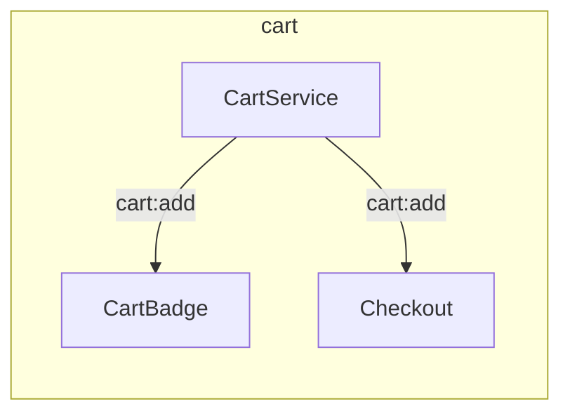

# Documentation system for Slice projects — design

**Status:** design approved. Phase 1 implemented in `slicejs-cli`: `slice docs generate/check`,
category guides, `CLAUDE.md`, event documentation and `slice init` seeding. Phase 2 integrations and
the skill update remain pending.
**Scope:** generated Slice projects (`slice init`) and the shared
`slice-js-developer` skill. The workspace policy in
[`DOCUMENTATION.md`](./DOCUMENTATION.md) still governs this repository; this document
defines the documentation system that the CLI and skill install into a project.

## 1. Problem

Slice projects have good framework and component catalogs, but the project itself has no
predictable documentation layer for agents. The current gaps:

- `AGENTS.md` is not part of the scaffold, so every project invents its own instructions.
- Component categories exist in `sliceConfig.paths.components`, but nothing documents what each
  category is for or which components it owns.
- The event graph generated by `slice types generate` is machine-readable only. It is not consumed
  as human documentation, and it currently includes spec/test files as emitters.
- The skill has no rule for documenting a feature, bug, component, event-contract or CLI change.
- `src/markdown` is a docs-site implementation detail. It should not be copied into every project;
  apps need docs next to the module.
- Generated information (`components.js`, types, event graph) and authored documentation can drift
  because they have no shared source or check.

The system must make documentation:

- **local** — next to the code it describes;
- **discoverable** — root `AGENTS.md` routes to the nearest category guide;
- **fresh** — generated facts are checked, authored facts are updated in the same change;
- **non-duplicated** — registry docs stay remote, app docs stay local;
- **cheap to maintain** — one generation command, not a command per artifact.

## 2. Principles

1. **Module-first.** Documentation lives with the module. No `src/markdown` in app projects.
2. **AGENTS.md is the router, not a second manual.** It points to the nearest category guide, the
   component README and the generated event docs.
3. **Visual and Service are registry categories.** Keep them. `slice get` installs there. Registry
   components keep their docs remote; local components document themselves locally.
4. **One catalog feeds every generated view.** `sliceConfig.paths.components`, the filesystem and
   the component registry are resolved once into `components.js`, AGENTS inventories and event
   category metadata.
5. **Generated inside markers, authored outside.** The generator owns only marked blocks. It never
   rewrites prose.
6. **No line limits.** Documentation can be long. Freshness is enforced by generation, checks and
   same-change updates, not by arbitrary caps.
7. **One entry point.** `slice docs generate` covers all project documentation assets, including
   types. Granular subcommands exist, but nobody has to remember them.
8. **No `features/` folder.** Feature history belongs to the module changelog when the user wants a
   changelog. The scaffold does not impose the workspace's `features/` convention.
9. **`CLAUDE.md` is a compatibility shim.** Always `@AGENTS.md`; no opt-out flag.

## 3. File model

```text
proyecto/
  AGENTS.md                         # root agent guide + generated category table
  CLAUDE.md                         # "@AGENTS.md" compatibility shim
  CHANGELOG.md                      # optional, user-owned

  src/Components/
    Visual/                         # registry category
      AGENTS.md                     # generated guide + inventory + local rules
      Button/
        Button.js
        Button.html
        Button.css
        Button.spec.js
      Card/
        ...

    Service/                        # registry category
      AGENTS.md
      FetchManager/
        FetchManager.js
      LocalStorageManager/
        LocalStorageManager.js

    Domain/                         # app category (example)
      AGENTS.md                     # authored category guide + generated inventory
      CHANGELOG.md                  # optional, user-owned
      CartService/
        CartService.js
        README.md                   # authored component docs
        CartService.spec.js
      PricingService/
        PricingService.js
        README.md

    AppComponents/
      AGENTS.md
      Dashboard/
        Dashboard.js
        Dashboard.html
        Dashboard.css
        README.md
        Dashboard.spec.js

  docs/
    events/
      index.md                      # generated summary + drift
      cart.md                       # generated, one file per namespace
      router.md
      diagram.mmd                   # generated Mermaid
      diagram.html                  # generated self-contained HTML + inline SVG
```

### 3.1 What lives where

| Artifact | Owner | Generated? |
| --- | --- | --- |
| `AGENTS.md` root | CLI seed + team edits + generated category block | Mixed |
| `src/Components/<Category>/AGENTS.md` | generated inventory + authored category prose | Mixed |
| `<Component>/README.md` | team/agent | Authored |
| `CHANGELOG.md` | team/agent | Authored, optional |
| `docs/events/*` | `slice docs generate events` | Generated |
| `src/slice-events.generated.js` | `slice docs generate types` | Generated |
| `src/slice-build.generated.d.ts` | `slice docs generate types` | Generated |
| `src/Components/components.js` | `slice docs generate agents` / component commands | Generated |
| `src/markdown` | library docs only (`slicejs-components`, `slicejs_docs`) | Not part of app scaffold |

`src/markdown` remains valid in the two docs repositories because their parser reads it. It is not
generated or recommended in app projects.

## 4. AGENTS.md contract

### 4.1 Root `AGENTS.md`

Created by `slice init` when missing. It contains:

- project purpose and stack/version;
- read order: root → nearest category `AGENTS.md` → component `README.md`;
- commands (`dev`, `build`, `slice docs generate`, `slice docs check`);
- generated category table;
- documentation map (category guides, event docs, optional changelog);
- completion checklist.

The category table is the only generated block:

```md
## Component categories

<!-- slice:generated:categories:start -->
| Category | Type | Path | Components | Guide |
| --- | --- | --- | --- | --- |
| Visual | Visual | `src/Components/Visual` | 14 | [AGENTS.md](src/Components/Visual/AGENTS.md) |
| Service | Service | `src/Components/Service` | 3 | [AGENTS.md](src/Components/Service/AGENTS.md) |
| Domain | Service | `src/Components/Domain` | 5 | [AGENTS.md](src/Components/Domain/AGENTS.md) |
<!-- slice:generated:categories:end -->
```

Everything outside the markers is authored. `slice docs generate agents` updates the block and
never rewrites the prose.

### 4.2 Category `AGENTS.md`

Every category in `sliceConfig.paths.components` gets one.

**Visual and Service** are registry categories, so their guide is generated from a real template:

- what the category is for;
- the registry rule: components installed with `slice get` are not edited by hand; their
  authoritative docs are `slice docs` / MCP;
- how to add a local component in that category;
- generated inventory with component name, files and docs route;
- a short preserved "Local notes" section.

**Custom categories** are app-owned. `slice init` / `slice docs generate agents` creates the file
from `sliceConfig.paths.components.<Category>.description` when available. The file is expected to
be replaced with real documentation:

```md
# Domain

## What this category is

Business rules and application state. No DOM, no templates, no CSS.

## When to add something here

- A reusable business rule.
- A service that several screens share.
- State that must outlive a component tree.

## What does not belong here

- Visual components.
- Presentation-only state.
- Event names with no namespace.

## Components

<!-- slice:generated:components:start -->
| Component | Type | Files | Docs |
| --- | --- | --- | --- |
| CartService | Service | 1 | [README](./CartService/README.md) |
| PricingService | Service | 1 | [README](./PricingService/README.md) |
<!-- slice:generated:components:end -->

## Contracts and events

- `cart:add` is emitted by `CartService`, listened to by `CartBadge`.
- See [`docs/events/cart.md`](../../../docs/events/cart.md).

## Local rules

- Subscribe in `init()`, never in setters.
- A service never builds UI.
- Emit domain events with a namespace.

## Known gotchas

- `CartService` is a singleton; do not rebuild it per screen.
```

`slice docs check` warns when a custom category still has an empty purpose or the generated
placeholder text. It does not enforce a line count.

### 4.3 `CLAUDE.md`

Always:

```md
@AGENTS.md
```

Claude Code v2.1.277+ reads `AGENTS.md` directly when no `CLAUDE.md` exists; older versions and some
configurations read `CLAUDE.md`. The import keeps both working without duplicating content. OpenCode
prefers `AGENTS.md` and falls back to `CLAUDE.md`; the shim is harmless.

No `--no-claude-md` flag. The file is one line and can be deleted by a user who does not want it.

## 5. Component `README.md` contract

Only **app-owned** components need a local README. Registry components keep their docs remote.

An app component README should answer:

- What is it for, and when should it not be used?
- Public props/API.
- Events emitted/listened, with namespaces.
- A minimal usage example.
- Lifecycle/singleton constraints.
- Gotchas learned during implementation.
- Link to the category changelog if one exists.

Example:

```md
# CartService

Domain service that owns the cart, pricing rules and checkout state.

## API

| Method | Contract |
| --- | --- |
| `add(sku, qty)` | Adds a line and emits `cart:add`. |
| `clear()` | Empties the cart and emits `cart:cleared`. |

## Events

- Emits `cart:add` with `{ sku, qty }`.
- Emits `cart:cleared` with no payload.
- Listens to `catalog:price-changed`.

## Rules

- Singleton. Build once from the Providers composition root.
- Never touches the DOM.
- Unknown SKUs fail before mutating state.

## Gotchas

- `cart:add` fires before persistence resolves; subscribers must tolerate the optimistic state.
```

`slice docs check` can warn when an app-owned component has no README. It does not require a README
for registry-installed components.

## 6. Changelog

Changelogs are optional and user-owned. The scaffold must not impose the workspace `features/`
convention.

Recommended shape when a project wants one:

- `CHANGELOG.md` root: release-level, Keep a Changelog format.
- `src/Components/<Category>/CHANGELOG.md`: optional, category-level.
- `src/Components/<Category>/<Component>/CHANGELOG.md`: only for components with their own release
  history; not generated by default.

`slice init` does not create a changelog. `AGENTS.md` mentions it as optional and links it when the
file exists. `slice docs check` never requires it.

A feature does not create a folder. It adds an entry to the module changelog if the project uses one:

```md
## [Unreleased]

### Added
- `TourService`: spotlight, interactive steps and persistence.

### Fixed
- Next no longer repositions the card before the target is measured.
```

## 7. Event documentation

### 7.1 Source

`slice docs generate types` continues to produce:

- `src/slice-events.generated.js` — machine manifest: declared payloads, static emitters/listeners,
  dynamic sites.
- Type declarations for `slice.build`, runtime shim and event registry.

`slice docs generate events` consumes the same graph and writes human documentation under
`docs/events/`.

### 7.2 Files

```text
docs/events/
  index.md
  <namespace>.md
  diagram.mmd
  diagram.html
```

- `index.md`: summary table by namespace, links to each namespace page, drift section, link to the
  machine manifest.
- `<namespace>.md`: events in that namespace with payload, emitters, listeners, category and
  `file:line`.
- `diagram.mmd`: full Mermaid graph, grouped by namespace/category.
- `diagram.html`: self-contained HTML with inline SVG. No CDN, no JavaScript, no runtime dependency.

Generated files start with a marker:

```md
<!-- Generated by `slice docs generate events`. Do not edit by hand. -->
```

Pruning only removes files under `docs/events/` that carry that marker. Authored files in the same
folder are preserved.

### 7.3 Namespaces

Event names must be `namespace:action`.

- `index.md` groups by namespace.
- `<namespace>.md` is generated per namespace; namespaces are slugified for filenames.
- Events without `:` are listed in the drift section as invalid.
- Dynamic names (`emit(\`cart:${id}\`)`) are listed separately and never presented as resolved.
- The diagram groups nodes by namespace and colours/annotates the owning component category.

Example namespace page:

```md
# cart events

## `cart:add`

Payload: `{ sku: string, qty: number }`

| Role | Component | Category | Source |
| --- | --- | --- | --- |
| emitter | CartService | Domain | `src/Components/Domain/CartService/CartService.js:42` |
| listener | CartBadge | Visual | `src/Components/Visual/CartBadge/CartBadge.js:18` |
| listener | Checkout | AppComponents | `src/Components/AppComponents/Checkout/Checkout.js:31` |
```

Example Mermaid:



### 7.4 Static graph rules

The shared event graph must:

- scan `src/**/*.js`;
- exclude `**/*.spec.js`, `**/*.test.js`, `dist`, `src/public` and
  `src/slice-events.generated.js`;
- record `file`, `line`, enclosing class and category;
- read `emit`, `subscribe`, `subscribeOnce` and their bound/service variants;
- keep dynamic sites in a separate list;
- expose the same graph to types, event docs and the debugger.

## 8. Catalog and sources of truth

### 8.1 One catalog, several views

```text
sliceConfig.paths.components + component folders + component files
                              │
                              ▼
                     componentCatalog
                    │        │        │
                    ▼        ▼        ▼
             components.js  AGENTS   event category map
                            inventories
```

- `sliceConfig.paths.components` is the category source of truth.
- The filesystem is the component source of truth.
- `components.js` is the runtime registry, generated from the catalog.
- The AGENTS inventories are generated views of the same catalog.
- The event docs use the same category mapping for each emitter/listener.
- Nobody hand-edits `components.js`.

`slice docs generate agents` reconstructs `components.js` and the generated blocks. `slice docs
check agents` fails when the files disagree.

### 8.2 Category metadata

`sliceConfig.paths.components.<Category>` keeps:

- `path`;
- `type`;
- optional `description`.

`description` is short metadata and a seed for a new category guide. It is not the formal
documentation. The category `AGENTS.md` is authoritative. When both change, update the guide; the
description can stay a one-line summary.

### 8.3 Registry components vs local components

`Visual` and `Service` are where `slice get` installs registry components. The category guide states:

- registry components are not edited locally;
- their docs are remote (`slice docs`, MCP);
- local components added to the same category follow the local README rule.

A future optional `src/Components/registry.lock.json` can record installed origin/version so the
inventory can show `Source: registry | local`. Phase 1 does not require it.

## 9. Commands

### 9.1 Entry point

```bash
slice docs generate            # everything: agents + types + events
slice docs generate agents     # components.js + AGENTS generated blocks
slice docs generate types      # .d.ts + slice-events.generated.js
slice docs generate events     # docs/events/*

slice docs check               # verify all generated artifacts
slice docs check agents
slice docs check types
slice docs check events
```

`slice docs list|search|get` remains the remote framework/components catalog. The local/project
half is `generate|check`; the remote half is `list|search|get`.

`slice types generate` remains as a compatibility alias for `slice docs generate types`.

### 9.2 Integration

| Command | Behavior |
| --- | --- |
| `slice init` | Seeds root `AGENTS.md`, `CLAUDE.md`, category `AGENTS.md` files and `components.js`. Never overwrites authored files. |
| `slice dev` | Runs `slice docs generate` at startup and watches component, config and route changes. Debounced regeneration. |
| `slice build` | Runs `slice docs check` before bundling. Fails with a clear "run slice docs generate" message when artifacts are stale. |
| `slice doctor` | Runs the same check plus docs health: missing category guides, placeholder purposes, app components without README, orphan event pages. |
| `slice component create` | Creates the component, updates the catalog and the generated category inventory. |
| `slice component delete` | Removes the component, updates the catalog and inventory. |
| `slice get` | Installs the registry component and updates the `Visual`/`Service` inventory. |
| `slice component list` | Keeps its table; uses the shared catalog and leaves `components.js` in sync. |

### 9.3 Why this is simpler

The agent only needs to remember:

- `slice init` to start;
- `pnpm dev` while working;
- `pnpm build` to verify;
- `slice docs generate` for a manual repair;
- `slice docs check` in CI.

No per-artifact command is required in the normal loop.

## 10. Skill changes

### 10.1 New reference

`repos/slice.js_docs/skill/slice-js-developer/references/documentation.md`

Contents:

- the module-first file model;
- read order: root `AGENTS.md` → nearest category `AGENTS.md` → component `README.md` → generated
  event docs;
- when to update which artifact:
  | Change | Update |
  | --- | --- |
  | Feature | category changelog (if used), component README, category AGENTS if the category changed |
  | Bug | regression test, component README/gotcha, changelog if user-facing |
  | New component | component README, category AGENTS inventory, generated docs |
  | New event | `slice.events.register`, `slice docs generate`, namespace page, tests |
  | Config/CLI | root `AGENTS.md`, framework/CLI docs, changelog |
  | Architecture | `docs/` design/ADR, category AGENTS, changelog |
- generated vs authored rules;
- `slice docs generate/check` usage;
- Visual/Service vs custom category rules;
- no line limits; freshness is the requirement;
- a closing "Docs updated / no docs impact" template.

### 10.2 SKILL.md changes

Short additions only:

- orientation protocol: read root and nearest category `AGENTS.md` before coding;
- decision rule: documentation is part of done;
- pointer to `references/documentation.md`;
- one paragraph about `slice docs generate/check` and generated event docs.

### 10.3 Other references

- `config-theming-cli.md`: new commands and `sliceConfig` category description.
- `state-and-routing.md`: event docs output and namespace rules.
- `gotchas-and-diagnostics.md`: stale generated docs, specs polluting the event graph, category
  guides vs registry docs.

### 10.4 Versioning

- Skill minor bump (`1.34.0`), manifest update, `pnpm sync:skill`.
- CLI minor bump for the new command surface.
- Framework docs page for the system. No framework runtime change is required.

## 11. Freshness and validation

No line limits. The rules are:

1. **Generated blocks are always current.** `slice docs check` compares them.
2. **Authored docs change in the same PR as behavior.** The skill enforces the read/update loop.
3. **`slice dev` regenerates.** The generated artifacts rarely go stale during work.
4. **`slice build` checks.** Stale generated docs fail before bundling.
5. **`slice doctor` adds health warnings.** Missing category purpose, missing app README, orphan
   event pages.
6. **Optional phase 2:** a git-based heuristic compares the last commit of a component source with
   its README; if the source is newer, warn "possible stale docs". This is advisory, not a gate.

Generated output must be deterministic: sorted keys, sorted components, no timestamps, no absolute
paths.

## 12. Implementation plan

### Phase 1 — CLI foundation

- Extract `componentCatalog` from the current `listComponents`/`Validations` logic.
- Extract `eventGraph` from `types/types.js`; exclude specs/tests/generated files; add category.
- Add `slice docs generate` and `slice docs check` with subcommands.
- Add `slice docs generate agents`:
  - `components.js`;
  - root category block;
  - category `AGENTS.md` creation and inventory blocks;
  - preserve authored content.
- Add `slice docs generate types` (move current behavior; keep `slice types generate` alias).
- Add `slice docs generate events`:
  - `docs/events/index.md`;
  - namespace pages;
  - `diagram.mmd`;
  - self-contained `diagram.html`;
  - pruning by generated marker.
- Tests:
  - category discovery;
  - marker merge preserves prose;
  - init idempotence;
  - event exclusions;
  - namespace grouping;
  - dynamic sites;
  - check exit codes;
  - command aliases.

### Phase 2 — Integrations

- `slice init` seeds `AGENTS.md`, `CLAUDE.md`, category guides, `components.js`.
- `slice dev` runs generation and watches.
- `slice build` runs `slice docs check`.
- `slice doctor` adds docs health.
- `component create/delete`, `get`, `list` use the shared catalog and update inventories.
- Contract tests for each command.

### Phase 3 — Skill and docs

- Add `references/documentation.md`.
- Update `SKILL.md` and the related references.
- Bump skill and manifest; run `pnpm sync:skill` and `pnpm check:skill`.
- Add the framework docs page for the documentation system and CLI commands.
- Run docs generation and link checks.

### Phase 4 — Pilot

- Apply the scaffold to `slicejs-components` and/or Conclave.
- Verify that category guides are useful, not boilerplate.
- Verify `slice docs check` catches drift.
- Verify the event docs are readable and the HTML diagram opens offline.
- Adjust templates before declaring the system stable.

## 13. Out of scope / future

- Migrating `slicejs-components/src/markdown` or `slicejs_docs/markdown` to module-first docs.
  Those repos keep their parser and catalog pipeline.
- `registry.lock.json` origin/version tracking for installed components.
- Generated "Used by" references for app components. Phase 1 leaves this manual; phase 2 can add a
  best-effort static reference scan.
- Per-component changelogs by default.
- A local docs server for `docs/events/*`. The files are readable as Markdown/HTML; a project can
  serve them if it has a docs route.
- Auto-writing README prose. The CLI creates seeds and inventories; authors write the documentation.

## 14. Acceptance criteria

The design is implemented when:

- `slice init` creates `AGENTS.md`, `CLAUDE.md`, one guide per category and `components.js`.
- `slice docs generate` produces types, event docs and AGENTS inventories deterministically.
- `slice docs check` fails on drift and passes on a clean generated tree.
- `slice dev` regenerates and `slice build` rejects stale artifacts.
- `slice component create/delete` and `slice get` keep `components.js` and the category inventory in
  sync.
- Event docs live under `docs/events/`, group by namespace, include Mermaid and self-contained HTML,
  and exclude specs/tests.
- The skill reads the root and nearest category `AGENTS.md` before coding and documents the
  update/close checklist.
- A pilot project can add a component or event and finish with no hand-edited generated file.

## 15. Implementation status

### Done (2026-11-14)

- `commands/utils/componentCatalog.js` scans `sliceConfig.paths.components`, the category folders and
  the component files into one catalog.
- `commands/docs/agents.js` writes `components.js`, root `AGENTS.md`, one guide per category and
  `CLAUDE.md`, with generated markers that preserve authored prose.
- `commands/docs/events.js` writes `docs/events/index.md`, one page per namespace, `diagram.mmd` and
  a self-contained `diagram.html` with inline SVG.
- `commands/docs/index.js` provides `slice docs generate [all|agents|types|events]` and
  `slice docs check [all|agents|types|events]`.
- `slice types generate` remains an alias of `slice docs generate types` through the existing
  command.
- The static event graph excludes `*.spec.js`, `*.test.js`, generated files and `src/public`, and
  records the component category.
- `slice init` seeds the agent docs after installing the starter components.
- `slice component create/delete` and `slice get/sync` update the catalog and category inventories.
- `slice doctor` has a Documentation row that checks AGENTS inventories and event docs.
- `slice build` runs `slice docs check` for projects that already have the scaffold
  (`AGENTS.md` + `docs/events/index.md`); older projects are untouched.
- `slice dev` regenerates all documentation assets before starting the watch server. Automatic
  generation is gated on the scaffold marker (`AGENTS.md` with generated markers or
  `docs/events/index.md`), so hand-written `AGENTS.md` files are left alone.
- `repos/slice.js_docs/skill/slice-js-developer` v1.34.0: new
  `references/documentation.md`, SKILL.md read/document/write rules, and updates to the CLI, events
  and diagnostics references. The vendored workspace skill is in sync.
- `slicejs_docs` has a new `Documentation & AGENTS.md` page at
  `/Documentation/Documentation-System`, plus updates to CLI, project anatomy, development loop,
  sliceConfig, event manager/registry and the docs landing tooling cards. `llm.txt` was regenerated.
- `slice component list` is now a compact category summary by default, with `--all`,
  `--category` and `--json`; `slice dev` no longer prints the component table.
- CLI output pass: one symbol per severity in `Print`, clean help descriptions, `slice` as the
  program name, compact `browse`, no emoji prefixes, and stack traces only with `SLICE_DEBUG`.
- Server log pass: no duplicate "server running" line after the CLI READY block, no per-request
  bundle logs, and security warnings ("framework file accessed without a valid referer",
  suspicious requests) only with `SLICE_DEBUG=1`, deduplicated per category.
- Tests in `repos/slicejs-cli/tests/docs-generate.test.js` cover the catalog, AGENTS merge, types,
  namespaces, event exclusions, diagrams and drift checks.
- Pilot in a temporary Conclave worktree: six categories discovered (`AppComponents`, `Core`,
  `Domain`, `Providers`, `Visual`, `DataDisplay`), category descriptions seeded the guides,
  app-owned components no longer emit a fake remote docs command, and `slice docs check agents`
  passed. The worktree was removed; no Conclave files were changed.

### Pending

- Adopt the scaffold in `slicejs-components` / Conclave for real, if desired.
- CLI/framework version bump and commit (changelog entries are in `[Unreleased]`).
- Optional `registry.lock.json` origin tracking and generated "Used by" references.
